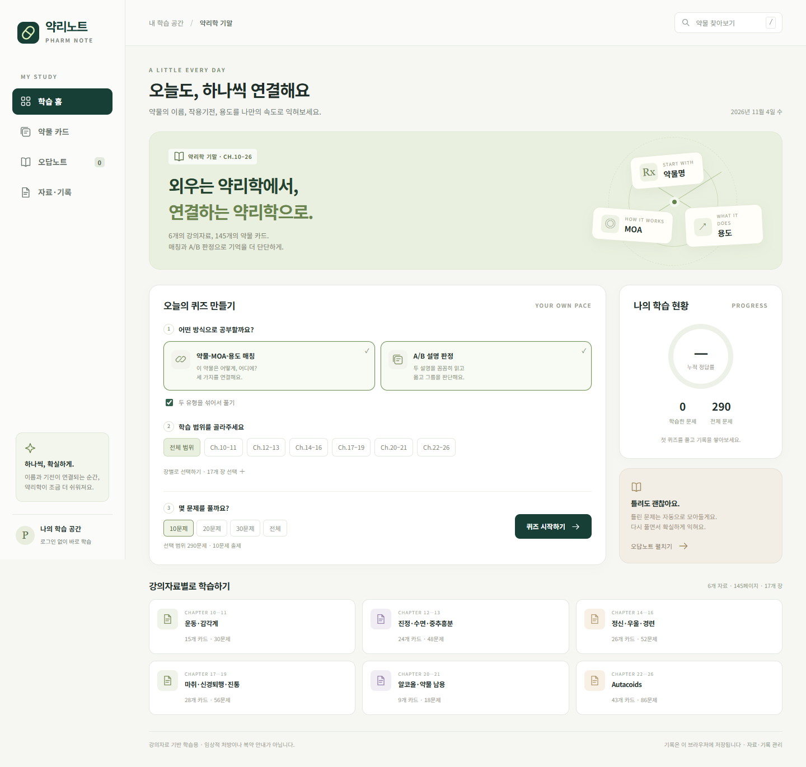
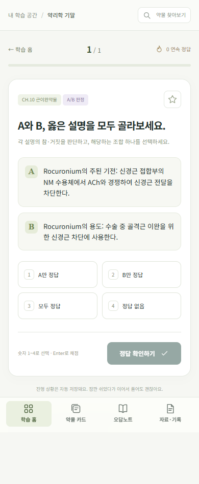

# 약리노트 · 약리학 학습 퀴즈

약리학 기말 강의자료 6개(Ch.10–26, 총 145쪽)를 바탕으로 **약물명·작용기전(MOA)·용도를 연결해서 학습하는 웹앱**입니다. 한국어 화면으로 PC와 모바일에서 사용할 수 있으며 로그인, API 키, 유료 서비스가 필요하지 않습니다.

- **앱 실행:** https://pharm-quiz-study-20261104.starryaisle2.chatgpt.site
- **GitHub 저장소:** https://github.com/seeum0121-debug/Harness-Engineering
- **문제 구성:** 약물 카드 145개 · 매칭형 145문제 · A/B 판정형 145문제



## 목적과 주요 기능

약물의 이름만 외우는 대신 **어떻게 작용하는지, 어떤 용도와 연결되는지** 함께 익히도록 설계했습니다.

### 1. 약물명·MOA·용도 매칭

제시된 약물에 맞는 MOA와 용도를 각각 4개의 보기에서 하나씩 선택합니다. **두 연결이 모두 맞아야 한 문제의 정답**으로 처리합니다. 채점 후 각 연결의 정오, 해설, 원본 PDF 페이지가 표시됩니다. 보기의 순서는 매번 섞입니다.

### 2. A/B 설명 판정

A와 B에 제시된 설명을 읽고 아래 네 선택지 중 하나를 고릅니다. 선택지 번호와 순서는 항상 동일합니다.

1. A만 정답
2. B만 정답
3. 모두 정답
4. 정답 없음

각 문장의 정오와 틀린 설명의 올바른 내용을 해설로 확인할 수 있습니다. 키보드 숫자 `1`–`4`로 선택하고 `Enter`로 채점할 수도 있습니다.

### 학습 편의 기능

- 두 유형을 따로 풀거나 혼합해서 풀기
- 자료별·장별 범위 선택, 10/20/30/전체 문제 선택
- 약물명·MOA·용도 검색, 약물 카드 저장
- 틀린 문제 자동 수집, 정답을 맞힐 때까지 오답 복습
- 퀴즈 점수, 누적 정답률, 최대 연속 정답, 최근 완료 기록
- 새로고침·페이지 이동 후 진행 중인 퀴즈 이어 풀기
- 학습 기록 JSON 내보내기·가져오기
- PC, 태블릿, 모바일 화면 대응

## 실행 방법

### 가장 간단하게: 설치 없이 실행

저장소를 ZIP으로 내려받아 압축을 푼 뒤 **`dist/index.html`을 브라우저로 열면** 됩니다. `dist` 안의 파일과 하위 폴더를 함께 보관하세요. 인터넷 연결이나 Node.js가 없어도 이 방식으로 학습할 수 있습니다.

### 로컬 서버로 실행

Node.js 22 이상을 권장합니다. 실행 서버는 Node.js 기본 모듈만 사용하므로 패키지 설치 없이 실행됩니다.

```bash
git clone https://github.com/seeum0121-debug/Harness-Engineering.git
cd Harness-Engineering
npm start
```

브라우저에서 `http://127.0.0.1:4173`에 접속합니다. 서버 종료는 터미널에서 `Ctrl+C`를 누릅니다. Windows PowerShell에서 npm 실행 정책 오류가 나면 `npm.cmd start`를 사용합니다.

### 문제 수정과 개발

```bash
npm ci
npm run build
npm test
npm run test:e2e
```

- `npm run build`: `content/*.json` 검증 후 배포용 문제은행 생성
- `npm test`: 채점·기록·백업 복원 로직 검증
- `npm run test:e2e`: Chrome을 이용한 실제 브라우저 기능 검증
- Chrome이 설치되지 않은 환경에서는 `npx playwright install chromium` 후 `CI=1 npm run test:e2e`로 실행합니다. PowerShell에서는 먼저 `$env:CI='1'`을 설정합니다.

## 자료 범위와 출처

| 파일 | 범위 | 원본 쪽수 | 카드 / 문제 |
| --- | --- | ---: | ---: |
| section3 (ch10-11).pdf | 근이완·국소마취 | 15 | 15 / 30 |
| section4 (ch12-13).pdf | 진정수면·항불안·중추흥분 | 21 | 24 / 48 |
| section4 (ch14-16).pdf | 항정신병·항우울·항경련 | 30 | 26 / 52 |
| section4 (ch17-19).pdf | 전신마취·신경퇴행·마약성 진통 | 29 | 28 / 56 |
| section4 (ch20-21).pdf | 알코올·약물 남용 | 14 | 9 / 18 |
| section5 (ch22-26).pdf | Histamine·Serotonin·Angiotensin·PG/LT·NO | 36 | 43 / 86 |

카드와 해설에는 파일명과 **PDF 뷰어에서 1부터 세는 페이지 번호**를 표시했습니다. 같은 약물이 서로 다른 장의 맥락에서 등장하는 경우 별도 카드로 구성되어 있으므로 145개는 고유 약물 수가 아닌 카드 수입니다. 주요 약물을 선별한 문제집이며 자료에 등장하는 모든 약물을 포함한다는 의미는 아닙니다.

원본 PDF와 추출 원문은 저장소·웹앱에 포함하지 않았습니다. 문제는 제공된 자료를 근거로 작성한 고정 문제은행이며, 실행 중 AI나 외부 API를 호출하지 않습니다. 논란이 있는 임부 안전성, 허가 현황, 단정적인 부작용 표현은 문제에서 배제하거나 자료의 학습 맥락으로 제한했습니다. 본 앱은 시험 공부용이며 임상 처방이나 복약 안내를 제공하지 않습니다.

## 저장 방식

학습 기록은 `localStorage`의 `pharmnote:v1` 키에 저장됩니다. 계정이나 서버 데이터베이스가 없고 기기 간 자동 동기화는 하지 않습니다. 다른 브라우저·기기·접속 주소에서는 별도의 기록을 사용합니다. 시크릿 모드 종료나 사이트 데이터 삭제 시 기록이 사라질 수 있으므로 **자료·기록 → 학습 기록 내보내기**로 보관할 수 있습니다.

## 코드 구조

```text
content/                 검토 가능한 원본 학습 카드·문제 JSON
dist/
  index.html             앱 진입점
  styles.css             PC·모바일 반응형 화면
  app.js                 화면·이벤트·학습 기록 관리
  engine.js              퀴즈 추출·채점·상태 복원 로직
  data/question-bank.js  검증된 배포용 문제은행
scripts/
  build-data.cjs         문제 구조·출처 검증 및 데이터 생성
  serve.cjs              외부 의존성이 없는 로컬 정적 서버
  extract-pdfs.py        로컬 PDF의 집필용 텍스트 추출 도구
tests/                   Node.js 단위 검증과 Playwright 브라우저 검증
docs/                    실행 검증 기록과 화면 예시
```

`dist/` 폴더 전체를 정적 웹 호스팅에 올리면 동일하게 실행됩니다. 출처 PDF 추출 스크립트는 문제 집필을 위한 보조 도구이며 앱 실행에는 Python이나 PDF 라이브러리가 필요하지 않습니다.

## 실행 검증

실제 Chrome에서 PC(1440px), 모바일(390px·320px)로 실행했습니다. 자동화한 채점 검증과 화면별 결과는 [실행 검증 기록](docs/VALIDATION.md)에 정리했습니다.



## 과제 제출용 설명

> 약리학 강의자료 6개를 활용해 약물명·작용기전·용도를 복습하는 웹앱 ‘약리노트’를 개발했습니다. 약물명에 맞는 MOA와 용도를 연결하는 매칭 퀴즈와 A/B 설명의 정오를 판단하는 퀴즈를 제공합니다. 총 290문제에 해설과 원본 페이지를 표시했고, 오답노트·약물 검색·학습 기록 저장 기능을 구현했습니다. PC와 모바일에서 실제 실행하며 채점과 주요 학습 흐름을 검증했습니다.

제출 저장소: https://github.com/seeum0121-debug/Harness-Engineering
