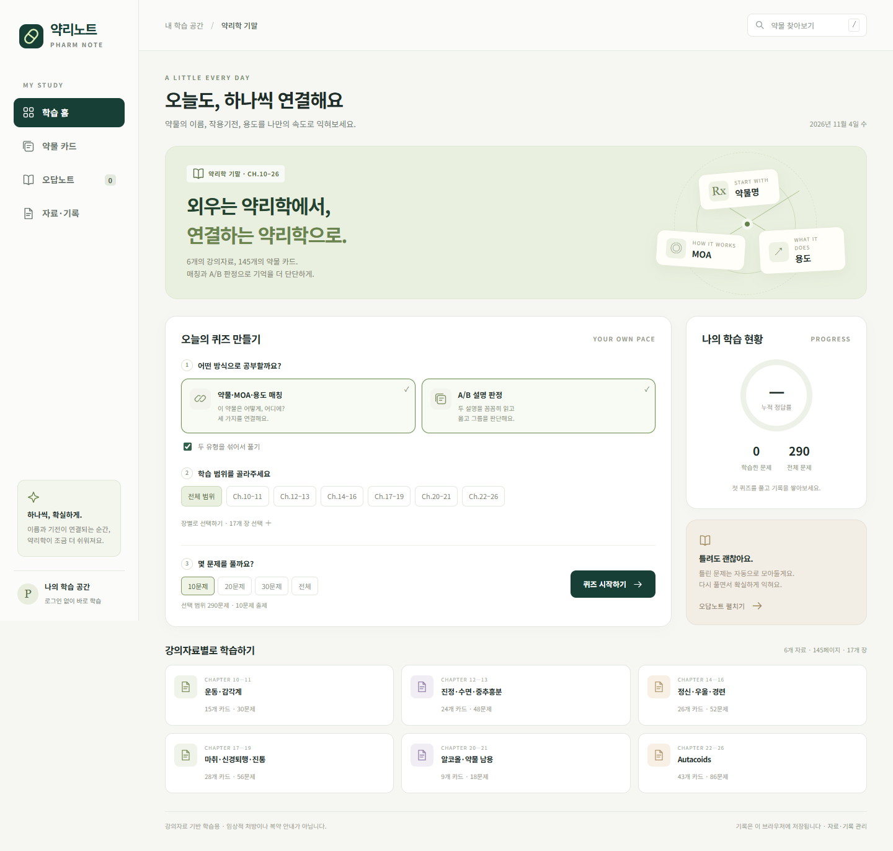
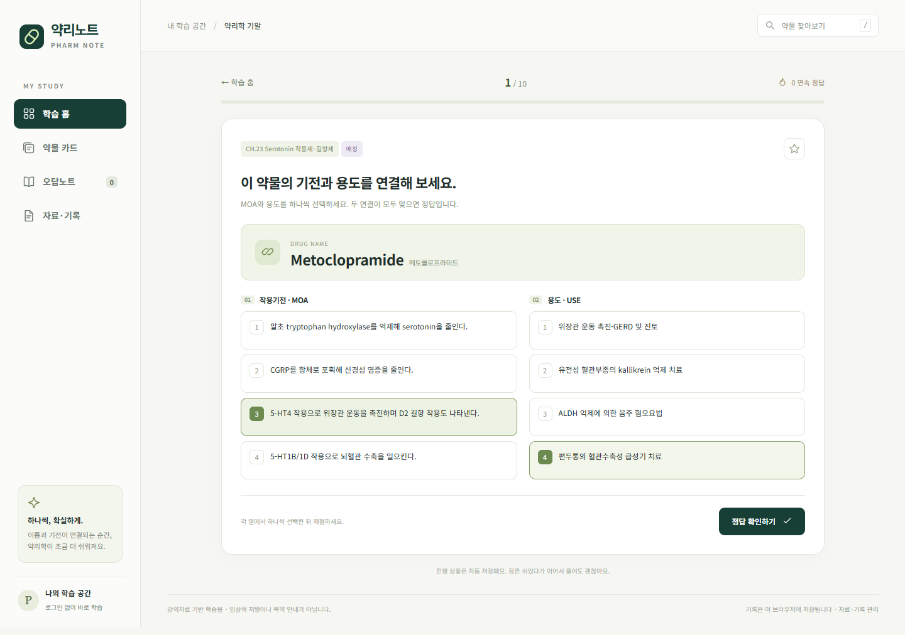
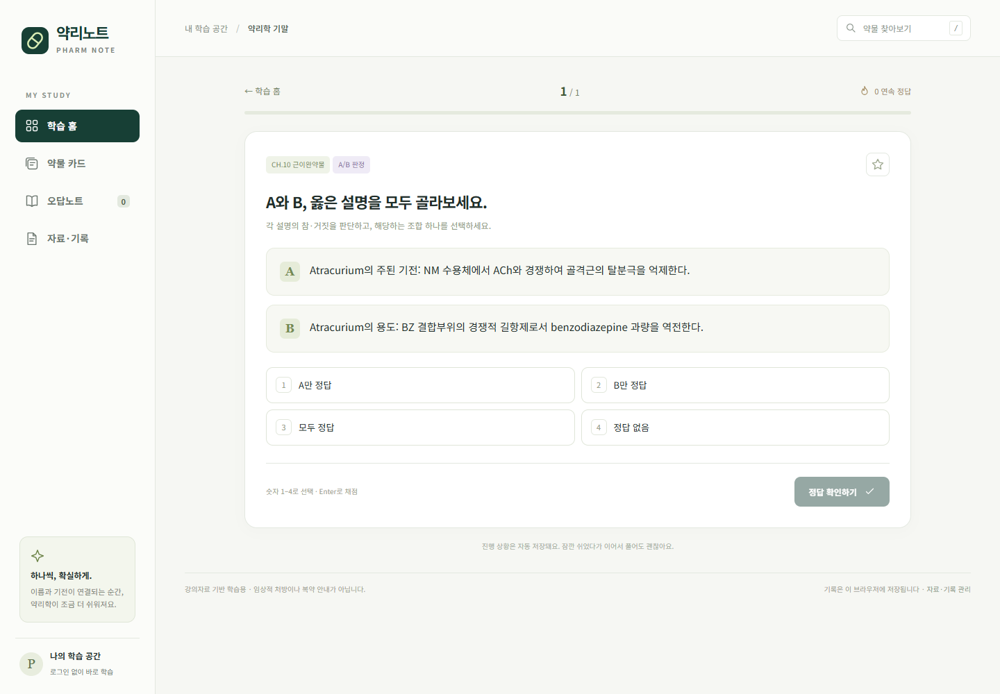
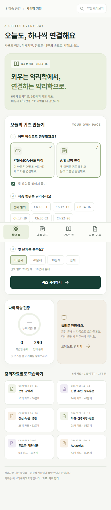
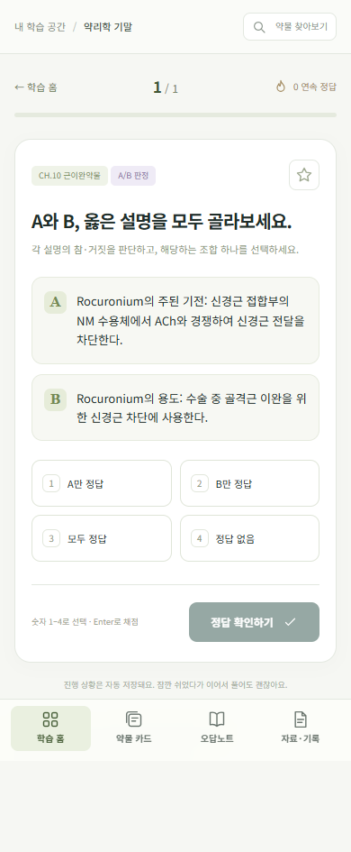

# 실행 검증 기록

검증일: 2026-11-04. Windows, Node.js 24.21.0, Chrome 156, Playwright 1.64.1 환경에서 실행했습니다.

## 콘텐츠 검증

- PDF 6개, 145페이지에서 Ch.10–26의 주요 약물을 선별했습니다.
- 카드 145개에서 매칭 145문제·A/B 145문제를 생성했습니다.
- 모든 장의 포함 여부, ID 중복, 보기 중복, 정답 인덱스, 출처 페이지 범위를 검사했습니다.
- 서로 다른 검토 과정에서 기전·용도 보기와 A/B 정오를 교차 검토했습니다.
- Tetrodotoxin은 연구용 사례임을 명시했습니다. Cannabidiol은 강의자료에 소개된 제안 기전과 정확한 인간 항경련 기전의 확립 여부를 구분했습니다. 후자는 [공식 제품 정보 12.1](https://dailymed.nlm.nih.gov/dailymed/drugInfo.cfm?setid=8bf27097-4870-43fb-94f0-f3d0871d1eec)도 참조했습니다.
- 원자료 전체를 대체하는 문제집이나 임상적 의사결정 도구는 아닙니다.

## 로직 검사: 8개 통과

명령: `npm run check`

| 확인 항목 | 결과 |
| --- | --- |
| 17개 장·6개 자료에서 두 문제 유형 생성 | 통과 |
| 모든 매칭 문제에서 MOA·용도 모두 맞을 때만 정답 | 통과 |
| A/B 참·거짓 4개 조합 및 고정 번호 | 통과 |
| 범위 필터·문제 수 상한·중복 없는 추출 | 통과 |
| 중복 채점 방지·오답 재도전 후 자동 해제 | 통과 |
| 새로고침 후 선택지 순서·채점·진행 상태 복원 | 통과 |
| 잘못된 백업 형식·알 수 없는 ID·오염된 세션 처리 | 통과 |
| 완료 점수·연속 정답·학습 이력의 저장 및 복원 | 통과 |

## 브라우저 검사

명령: `npm run test:e2e`

| 사용 시나리오 | 확인 내용 |
| --- | --- |
| PC 매칭 10문제 | 한 항목만 선택하면 채점 불가, 1개 오답 + 9개 정답 = 90점 |
| 새로고침·이어 풀기 | 채점한 문제와 선택지 순서·해설 보존 |
| 오답 복습 | 이전 오답을 맞히면 오답노트에서 제거 |
| 출처 보기 | 파일명, PDF 페이지, 전체 쪽수 표시 |
| A/B 4개 정답 패턴 | 고정 번호, 숫자 키 선택, Enter 채점, 결과 100점 |
| 약물 카드 | 검색·저장·저장 필터·기전 및 용도 펼치기 |
| 학습 기록 관리 | JSON 백업, 초기화, 재가져오기, 잘못된 JSON 거부 |
| 모바일 390px·320px | 가로 넘침 없이 화면 표시, 매칭·A/B 채점 가능 |
| 장별 선택 | 선택 해제 시 시작 비활성화, Ch.10 선택 시 해당 장만 출제 |
| 진행 중 새 퀴즈 | 교체 확인 및 취소 시 이전 퀴즈 유지 |
| 파일 직접 실행 | 서버 없이 `dist/index.html`을 열어 퀴즈·채점 가능 |
| 저장소 접근 제한 | 안내 표시 후 메모리에서 계속 학습 가능 |

처음 브라우저 검증에서 ‘Rocuronium’ 검색 결과를 1개로 가정한 테스트가 실패했습니다. 검색은 기전·용도 본문도 대상으로 하므로 Sugammadex 카드가 함께 검색되는 것이 정상입니다. 정확한 약물명 제목을 지정하도록 테스트를 수정했고 해당 시나리오는 재검증을 통과했습니다.

## 화면 예시

